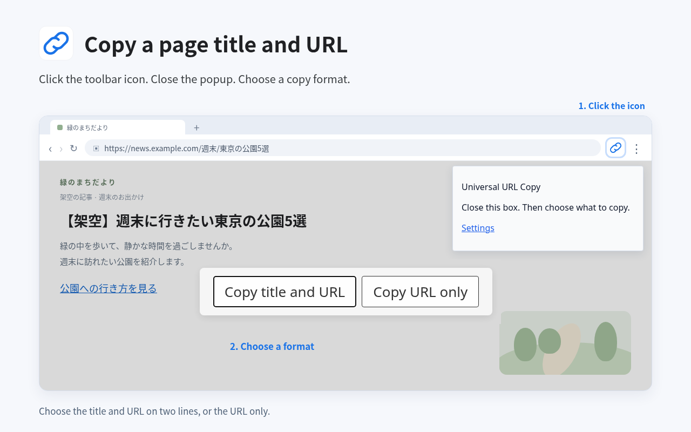
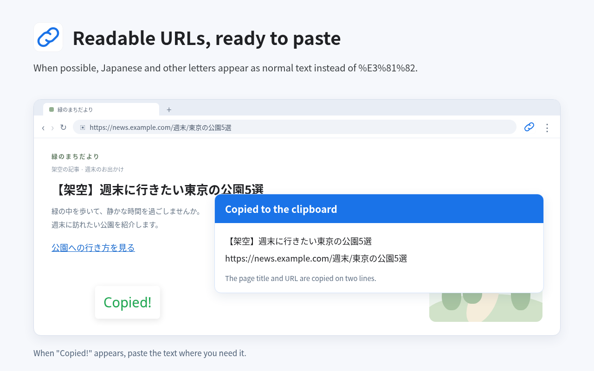

# Universal URL Copy

Universal URL Copy is a Chrome extension that copies the title and address of the page you have open.
You can also copy a page or a link from the right-click menu.
Choose the title and address on two lines, or the address only.
When possible, Japanese and other letters show as normal text, such as あ instead of %E3%81%82.





## Install

Install Universal URL Copy from the [Chrome Web Store](https://chromewebstore.google.com/detail/universal-url-copy/ejpfllmhmddjegfcnbnjmfgppgajlkfl).
The store may show an older version until the update is published.

To load the files from this repository, follow these steps.

1. Clone this repository, or choose "Code" and "Download ZIP" on its GitHub page.
2. If you downloaded the ZIP, extract it.
3. Open `chrome://extensions` in Chrome.
4. Turn on "Developer mode".
5. Click "Load unpacked" and select the folder that contains `manifest.json`.

## Copy a page or link

1. Open the page you want to copy.
2. Click the Universal URL Copy icon in the toolbar.
3. Close the small box that opens under the icon.
4. Choose "Copy title and URL" or "Copy URL only" on the page.
5. When "Copied!" appears, paste the text where you need it.

You can also right-click the page and choose "Copy page".
To copy a link, right-click the link and choose "Copy link".
You choose what to copy each time unless you turn on "Copy right away".
Press Esc or click outside the choice box to cancel.
If an error appears on the page, click "Try again" to try the copy again.

To skip the choice box, open "Settings" in the box under the toolbar icon.
Choose an option under "What to copy" and turn on "Copy right away (don't ask)".
Each change is saved when you make it. "Saved" appears when it is done.

## What gets copied

"Copy title and URL" puts the title on the first line and the address on the second line.
"Copy URL only" puts only the address on the clipboard.
The whole address is included, with everything after `?` or `#`.
Some parts, such as `%23`, stay as they are to keep the address working.
If the letters in an address cannot be made readable, the extension copies the original address.

For a link, the extension uses the link's text as the title.
If the link has no text, it uses the extra label that may appear when you hold the pointer over the link.
If that label is also empty, or the link cannot be found on the page, it uses the address as the title.
If several links in the same page have the same address, "Copy link" uses the text of the first one.
You can also select text inside a link on the main page, then click the toolbar icon to copy that link.

The extension's menus, settings, and messages are in English.
It cannot run on pages that Chrome blocks, such as `chrome://` pages and the Chrome Web Store.
The toolbar copies from the main page.
It does not copy a selected link inside a box that holds another page, video, or ad.
You can try "Copy link" inside such a box. Chrome may block copying there.
Within that box, the first link with the same address supplies the title.
If Chrome blocks the copy controls, the extension may also be unable to show an error or a "Try again" button.

## Permissions

The extension uses these five permissions.

| Permission | Why it is needed |
| --- | --- |
| `activeTab` | Lets the extension use the tab when you click its toolbar icon or choose "Copy page" or "Copy link". It does not ask for access to all websites all the time. |
| `scripting` | Runs the extension's copy code on the page after you start a copy. The code reads the title and address, shows the copy choices and messages, and copies the text. |
| `clipboardWrite` | Puts your chosen text on the clipboard. The extension does not read the text already on your clipboard. |
| `contextMenus` | Adds "Copy page" when you right-click a page or selected text, and "Copy link" when you right-click a link. |
| `storage` | Saves whether to copy right away and what to copy. The extension reads these settings when you open Settings or start a copy. |

## Privacy

The extension reads page data only after you start a copy and uses it only to make your clipboard text.
It does not save page data for later use or send it anywhere.
It can keep the latest copy target in memory for the choice box or a retry while the page is open.
Only the two settings are saved. Chrome may sync them with your Google account if Chrome sync is on.
The extension has no analytics or remote code and makes no network requests.
Read the [privacy policy](PRIVACY.md) for details.

## Build the store ZIP

You need Bash and Python 3.
From the repository folder, run this command.

```sh
bash store/build-zip.sh
```

The script creates `store/universal-url-copy-1.3.zip` and prints its size and SHA-256.
The ZIP contains the extension files needed for the store package.

## Report a problem

Report problems or ask questions through [GitHub Issues](https://github.com/s9610/universal-url-copy/issues).

## License

Universal URL Copy uses the [MIT License](LICENSE).

## 日本語

Universal URL Copy は、開いているページのタイトルとアドレスをコピーする Chrome 拡張機能です。
右クリックから、ページやリンクもコピーできます。
タイトルとアドレスを2行でコピーするか、アドレスだけをコピーするかを選べます。
日本語などの文字は、できる場合に %E3%81%82 のような表示から「あ」のような普通の文字に戻します。
上の2枚の画像は、コピーする内容の選択画面と、コピー完了の表示を示しています。

### インストールする

[Chrome ウェブストア](https://chromewebstore.google.com/detail/universal-url-copy/ejpfllmhmddjegfcnbnjmfgppgajlkfl)から Universal URL Copy をインストールできます。
更新版が公開されるまでは、ストアに古いバージョンが表示される場合があります。

このリポジトリのファイルを読み込む場合は、次の手順で進めます。

1. このリポジトリをクローンするか、GitHub のページで「Code」から「Download ZIP」を選びます。
2. ZIP をダウンロードした場合は、展開します。
3. Chrome で `chrome://extensions` を開きます。
4. 「デベロッパー モード」をオンにします。
5. 「パッケージ化されていない拡張機能を読み込む」をクリックし、`manifest.json` があるフォルダーを選びます。

### ページやリンクをコピーする

1. コピーしたいページを開きます。
2. ツールバーの Universal URL Copy のアイコンをクリックします。
3. アイコンの下に開いた小さな画面を閉じます。
4. ページに出る「Copy title and URL」か「Copy URL only」を選びます。
5. 「Copied!」と出たら、使いたい場所へ貼り付けます。

ページの上で右クリックし、「Copy page」を選んでも使えます。
リンクをコピーするときは、そのリンクの上で右クリックし、「Copy link」を選びます。
「Copy right away」をオンにしない限り、毎回コピーする内容を選びます。
Esc キーを押すか、選択画面の枠の外をクリックすると、キャンセルできます。
ページにエラーが出た場合は「Try again」でやり直せます。

毎回の選択を省く場合は、アイコンの下に開く画面の「Settings」を開きます。
「What to copy」で内容を選び、「Copy right away (don't ask)」をオンにします。
変更するたびに設定を保存します。保存が終わると「Saved」と出ます。

### コピーする内容

「Copy title and URL」は、1行目にタイトル、2行目にアドレスをコピーします。
「Copy URL only」は、アドレスだけをクリップボードにコピーします。
アドレスは、`?` や `#` の後ろもすべて含めてコピーします。
`%23` などの一部は、アドレスの働きを保つためにそのまま残します。
アドレスの文字を読みやすく戻せない場合は、元のアドレスをコピーします。

リンクの場合は、リンクの文字をタイトルとして使います。
リンクに文字がない場合は、ポインターを重ねたときに出ることがある補足の説明を使います。
その説明も空の場合や、ページ上でリンクを見つけられない場合は、アドレスをタイトルとして使います。
同じページに同じアドレスのリンクが複数あると、「Copy link」は最初のリンクの文字を使います。
ページ本体のリンク内の文字を選択してからツールバーのアイコンを押すと、そのリンクをコピーできます。

拡張機能のメニュー、設定画面、メッセージは英語です。
`chrome://` で始まるページや Chrome ウェブストアなど、Chrome が操作を制限するページでは使えません。
ツールバーからのコピーはページ本体が対象です。
別のページや動画、広告を表示する枠の中で選択したリンクはコピーしません。
そのような枠の中でも「Copy link」を試せます。ただし、Chrome の制限でコピーできないことがあります。
その枠の中でも、同じアドレスの最初のリンクからタイトルを取得します。
Chrome がコピー画面の表示を制限する場合は、エラーや「Try again」ボタンも出せないことがあります。

### 権限

この拡張機能は、次の5つの権限を使います。

| 権限 | 必要な理由 |
| --- | --- |
| `activeTab` | ツールバーのアイコンを押すか、「Copy page」や「Copy link」を選んだときに、そのタブでコピーを行うために使います。常にすべてのサイトを読み取る権限は求めていません。 |
| `scripting` | コピーを始めたときに、拡張機能に含まれるコピー用の処理をページ上で動かすために使います。タイトルとアドレスを読み取り、選択画面やメッセージを出して、文字をコピーします。 |
| `clipboardWrite` | 選んだ文字をクリップボードへコピーするために使います。コピー前のクリップボードの内容は読み取りません。 |
| `contextMenus` | ページや選択した文字を右クリックしたときに「Copy page」を追加します。リンクを右クリックしたときには「Copy link」を追加します。 |
| `storage` | すぐにコピーするかどうかと、コピーする内容を保存するために使います。設定画面を開いたときや、コピーを始めたときに読み取ります。 |

### プライバシー

拡張機能は、コピーを始める操作の後にだけページの情報を読み取り、クリップボードにコピーする文字を作るためにだけ使います。
後で使うためにページの情報を保存したり、どこかへ送ったりしません。
選択画面ややり直しのために、ページを開いている間は直近のコピー対象をメモリに一時的に保持することがあります。
保存するのは2つの設定だけです。Chrome の同期がオンの場合は、Google アカウントを通じて設定を同期することがあります。
拡張機能には利用状況を分析する仕組みやリモートコードがなく、ネットワーク通信も行いません。
詳しくは[プライバシーポリシー](PRIVACY.md)を参照してください。

### ストア用の ZIP を作る

Bash と Python 3 が必要です。
リポジトリのフォルダーで、次のコマンドを実行します。

```sh
bash store/build-zip.sh
```

スクリプトは `store/universal-url-copy-1.3.zip` を作り、サイズと SHA-256 を表示します。
ZIP には、ストア提出用に必要な拡張機能のファイルが入ります。

### 問題を報告する

不具合の報告や質問には [GitHub Issues](https://github.com/s9610/universal-url-copy/issues) を使ってください。

### ライセンス

Universal URL Copy は [MIT ライセンス](LICENSE)を使用しています。
